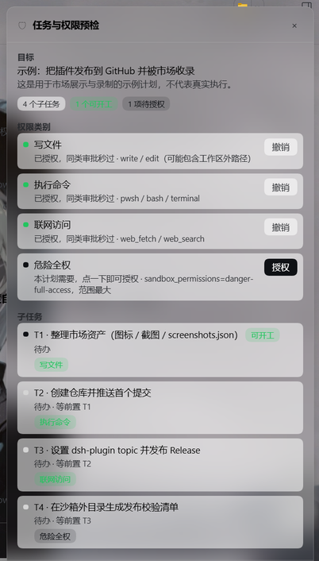

# 审批预检 · dsh-approval-preflight

> 先交计算图，再逐节点批准。批准的是「这件事」，不是某条命令；一次批准只对一次成功执行生效。

DeepSeek Harness 的插件。它解决的是 vibe coding 里真实的时间黑洞：审批请求没人及时点，工具调用同步等待，整轮就停在那里。

## 它做什么

1. **模型先交计算图**：把要做的事拆成节点，写清每件事的本质（下载什么到哪里、写什么、删什么、执行什么），并用 `dependsOn` 标出前后依赖，标出会碰外部世界的节点；
2. **用户逐节点批准**：右侧面板按依赖顺序列出节点，你点「批准」就是给了这件事**一次**执行许可；
3. **执行时只放行该节点申报的影响范围**：节点执行期间，同类工具调用自动放行；超出申报范围的一律退回原生审批卡；
4. **没人点审批就自动切换**：节点被未申报的审批卡住超过 `approvalTimeoutSeconds` 时，插件自动挂起该节点（批准保留），把「不依赖它的可做节点」交给模型继续，而不是让整轮停在那里；
5. **事后可审计**：每个节点都记录实际跑过什么（哪个工具、什么参数、成功与否），你随时能对照「批准的」和「实际做的」。

**权限只能由用户授予。** 模型没有任何工具能批准节点；面板走的是带登录凭据的宿主通道。

## 为什么不是「按权限类别一次性授权」

v1 的做法是「点一次执行命令 = 本会话所有命令免审」。那不是批准某件事，而是把整类权限交出去，授权面被悄悄放大，而且面板上看不出到底放行了什么。

v2 的语义：

| | v1（已废弃） | v2 |
| --- | --- | --- |
| 授权单位 | 权限类别（写文件/执行/联网） | 计算图上的一个节点（带语义描述） |
| 一次批准覆盖 | 本会话同类全部操作 | 该节点的一次成功执行 |
| 越界 | 同类操作静默放行 | 退回原生审批卡 |
| 失败重试 | 需要重新点头 | 批准不消耗，可直接重试 |
| 审批卡住 | 整轮阻塞 | 自动挂起节点，切到不依赖它的独立分支 |
| 事后 | 无从核对 | 节点级审计痕迹 |

## 使用流程（模型侧）

1. `preflight_graph`：提交计算图（goal + nodes）。节点字段：`id`、`title`、`effect`、`action`、`source`、`target`、`details`、`note`、`dependsOn`、`impacts`、`escalate`、`permission`；
2. 用户批准后，`preflight_node_start{id}` 开始执行一个节点；
3. 执行期间，该节点 `impacts` 覆盖的调用自动放行；不覆盖的走原生卡；
4. **卡住时自动切换**：未申报的审批超过 `approvalTimeoutSeconds` 没人点 → 该调用快速失败，当前节点转「已挂起」（批准保留、槽位释放），模型收到「不依赖它的可做节点」并直接切换过去；之后随时 `preflight_node_start` 续跑挂起节点；
5. `preflight_node_end{id, success}` 结束：成功消耗批准，失败保留批准可重试；
6. 中途要做新事：`preflight_graph_append` 追加节点（不会作废旧批准），而不是重写整图；
7. `preflight_status` 随时查看节点状态（含挂起）、待批准项、可执行/可续跑的节点。

**依赖决定切换范围**：候选节点必须已批准、依赖全部完成、且依赖闭包里不含被挂起的节点。所以 `dependsOn` 要写真实依赖——写错会让插件把「其实做不了」的节点当成可切换分支。

**影响类型**：`fs-write`（write/edit）、`exec`（pwsh/bash）、`network`（web_fetch/web_search）。其余工具（`terminal_*`、MCP 工具）不参与自动放行。

## 面板

- 顶部：目标 + 计数（待批准 / 执行中 / 已挂起 / 已完成 / 节点总数）；
- 计算图概览：按依赖**分层排布**，同层的独立分支并排、层间箭头表示流向；状态着色（挂起为琥珀色虚线），点击跳到对应卡片；
- 节点卡：影响类型徽标、节点标题、语义本质（动作 / 来源 / 目标）、模型补充说明、影响标签、`前置 / 后续` 依赖；
- 挂起节点额外显示挂起原因与「不依赖它的可做节点」；
- 操作：待批准 →「批准 / 拒绝」；已批准或已挂起 →「撤销批准」；执行中 → 不可操作；
- 审计：有历史记录的节点可展开「查看实际执行」，逐条显示工具、摘要与结果；
- 底部：一键批准全部待批准；提示「批准的是「这件事」，不是某条命令」。



## 配置

```yaml
- id: approval-preflight
  config:
    approvalTimeoutSeconds: 90   # 节点未覆盖的审批等待多久后让路；0 = 关闭让路
    nodeIdleSeconds: 600         # 节点执行超时自动挂起（不消耗批准）
    maxNodes: 80                 # 计算图节点上限
    wakeOnGrant: true            # 用户批准后主动唤醒模型
```

## 状态与断点续跑

没有独立数据库。计算图来自 `preflight_graph` / `preflight_graph_append` 的工具调用参数；批准来自注入的用户消息标记 `[[preflight:approve:<版本>:<节点>]]`；**挂起来自 `[[preflight:suspend:<版本>:<节点>]]`**；节点执行区间来自 `preflight_node_start` / `preflight_node_end`（挂起后再 start 即续跑）；审计来自区间内的 `tool/call` + `tool/result`。

重启后按事件顺序回放。回放异常（缺 start、版本不匹配、未知节点）一律 **fail-closed**：该批准按未批准/失效处理，宁可多问一次。

## 验证

```bash
npm test    # 或分别运行下面三个
node scripts/selftest.mjs        # 79 项：语义/图/依赖/状态机/挂起切换/回放/版本一致性
node scripts/contract-test.mjs   # 53 项：真实 index.js 的装配、输出 schema 校验与通道往返
node scripts/client-test.mjs     # 39 项：真实 client.js 在假浏览器里的渲染与交互（含分层图、挂起态）
```

离线测试覆盖模型侧工具、审批拦截、依赖切换、会话日志回放、面板渲染与通道往返。**真机（重启后）的确认清单**见
[docs/verify.md](docs/verify.md)：版本号三处对齐、一次完整的「登记 → 批准 → 执行 → 消耗 → 审计」链路、「审批卡住 → 自动挂起 → 切独立分支」场景，以及排错顺序。

上线前先跑 `npm run verify:loaded`：它读 Host 日志并对照 `package.json`，一条命令回答「现在跑的是不是这个构建、面板路由装没装成」。

## 已知限制

- **语义不可验证**：插件无法判断实际命令是否真的做了节点描述的事——这是信任边界。补偿手段是节点级审计痕迹（事后可核对）。
- **自动切换的前提是「已有独立分支且已批准」**：候选节点必须已批准、依赖完成、且不在被挂起节点的下游。没有这样的节点时，插件只能明确告诉你「没有可切换分支」，不会凭空造工作，也不会替你批准。
- **只在有执行中节点时自动切换**：没有节点在执行时，未申报的审批仍走原生卡（插件没有「当前未完成工作」可挂起）。
- **同一时刻只允许一个执行中节点**：代价是模型不能并行跑两个节点，换来干净的审计归属。
- **不自动放行 `terminal_*` 与 MCP 工具**：前者无法定义「一次调用」边界，后者无法归类。
- **不接管原生审批卡**：未申报的操作仍然弹原生卡，临时点的那一下只生效一次，不产生节点批准。
- 审计只记录工具调用摘要，不记录完整参数/输出。

## 目录

```
index.js              Host 入口：inject、工具注册、审批拦截、审计挂钩、通道安装
client.js             浏览器侧：状态条 + 分层计算图 + 节点面板（含挂起态）
lib/impacts.js        影响类型、工具归类、调用摘要
lib/graph.js          计算图校验、环检测、依赖闭包、就绪度、渲染
lib/state.js          会话状态机：图/节点/批准/挂起/切换/审计/回放/超时
lib/tools.js          五个模型侧工具
lib/rpc.js            面板通道端点（status / approve / reject / revoke）
lib/channel.js        认证过的自有路由
lib/prompt.js         系统提示词中的工作流规则（含挂起与切换）
lib/config.js         配置归一化
lib/version.js        版本常量（日志 / 面板 / 工具三处同源）
lib/messages.js       消息构造，批准与挂起标记
scripts/              三套离线测试 + verify:loaded 真机自检
docs/verify.md        重启后的真机验证清单与排错（含自动切换场景）
docs/grant-model.md   授权模型设计稿（结构与取舍，含依赖切换语义）
docs/prototype/       前端原型（HTML + 截图）
docs/design.md        平台机制与踩坑记录
```

## License

MIT
